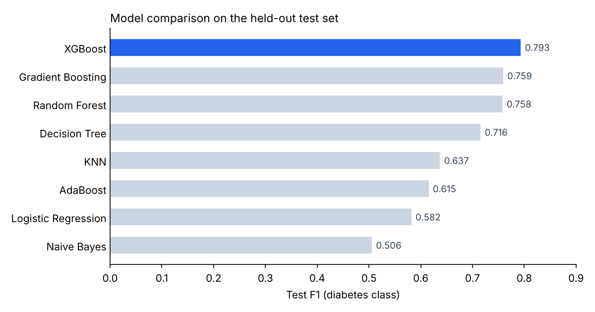
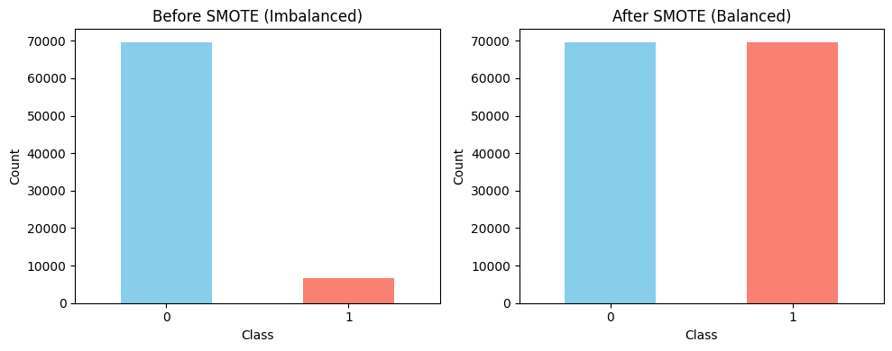

# Diabetes Prediction

End-to-end machine learning project that predicts diabetes from patient health indicators, starting from a deliberately noisy 100,000-row dataset (`PFA.ipynb`).

**Best model: XGBoost — 96.8% test accuracy, 0.793 F1 on the diabetes class, 0.976 ROC AUC.**

## Results

Eight classifiers were trained on SMOTE-balanced data and evaluated on an untouched test set (19,098 patients). Models that overfit were tuned with GridSearchCV and manual search.

| Model | Test Accuracy | Test F1 |
|---|---|---|
| **XGBoost** 🏆 | **0.968** | **0.793** |
| Gradient Boosting | 0.955 | 0.759 |
| Random Forest | 0.958 | 0.758 |
| Decision Tree | 0.949 | 0.716 |
| KNN | 0.922 | 0.637 |
| AdaBoost | 0.903 | 0.615 |
| Logistic Regression | 0.887 | 0.582 |
| Naive Bayes | 0.851 | 0.506 |

F1 is reported for the minority (diabetes) class, since only ~9% of patients are diabetic and accuracy alone would be misleading.



## Handling class imbalance

The training set had 69,630 non-diabetic vs 6,759 diabetic patients. SMOTE was applied to the training data only, so the test set keeps its real distribution.



## Workflow
- **Exploration** – data overview, unique values, missing-value analysis, distributions
- **Cleaning** – normalising inconsistent gender labels, fixing malformed BMI values, handling missing data
- **Correlation analysis** – heatmaps on numeric and one-hot-encoded features
- **Preprocessing** – scikit-learn `Pipeline` / `ColumnTransformer` (imputation, scaling, encoding)
- **Class balancing** – SMOTE on the training set
- **Modeling** – 8 classifiers compared on accuracy, F1 and ROC AUC, with overfitting checks and hyperparameter tuning
- **Final model** – XGBoost saved with `joblib`

## Dataset
`diabetes_prediction_dataset.csv` (included): 100,000 rows, a deliberately noisy version of the Kaggle [Diabetes prediction dataset](https://www.kaggle.com/datasets/iammustafatz/diabetes-prediction-dataset) with inconsistent labels, malformed BMI values and missing data.

## Run it
```bash
git clone https://github.com/isleeemm/diabetes-prediction.git
cd diabetes-prediction
pip install -r requirements.txt
jupyter notebook PFA.ipynb
```

## Tech stack
Python · pandas · NumPy · scikit-learn · imbalanced-learn · XGBoost · matplotlib · seaborn
